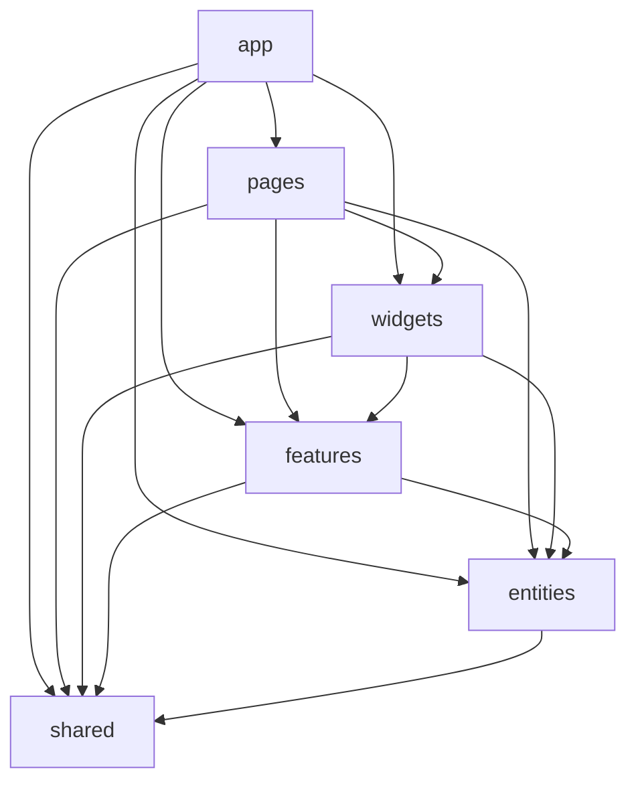

# Vue Lottery App

Лабораторна робота №6: SPA на Vue 3, організована за Feature-Sliced Design (FSD), із маршрутизацією, JWT-авторизацією та керуванням користувачами DummyJSON.

## Функціональність

- Головна сторінка з розіграшем, сторінка автора та сторінка 404.
- Vue Router із lazy-loaded сторінками, вкладеними маршрутами, метаданими сторінок і захищеними маршрутами.
- Вхід через DummyJSON Auth; токени зберігаються в `localStorage`, access token автоматично оновлюється при HTTP 401.
- Керування користувачами DummyJSON через сервіс-репозиторій, Pinia та спільний HTTP-клієнт.
- Пошук і пагінація з відображенням стану в URL, перегляд профілю, створення, редагування й видалення.
- Перевірка форм через VeeValidate і Yup.
- Pinia stores для сесії, користувачів і теми; тема зберігається через `pinia-plugin-persistedstate`.
- PrimeVue-компоненти із власними обгортками, сповіщення Toast і підтвердження дій.
- Перемикач світлої/темної теми.
- FSD-залежності перевіряються ESLint правилом `boundaries/dependencies`.

## Запуск

Потрібен Node.js відповідно до `engines` у `package.json`.

```sh
npm ci
npm run dev
```

Адреса API задається через `VITE_API_URL` у локальному `.env`. Приклад налаштування: [.env.example](./.env.example). Файл `.env` ігнорується Git.

Тестові облікові дані DummyJSON: `emilys` / `emilyspass`.

```sh
npm run lint
npm run lint:fsd
npm run type-check
npm run build
```

## Структура FSD



Стрілки показують напрямок залежності: кожен вищий шар може використовувати лише нижчі, а `shared` не залежить від бізнес-шарів.

## GitHub Pages

Workflow `.github/workflows/deploy.yml` збирає застосунок і публікує його на GitHub Pages після push до `feature/routing`. Для правильного base path workflow використовує назву репозиторію `vue-lottery-app`. У налаштуваннях репозиторію GitHub Pages має бути обране джерело **GitHub Actions**.
